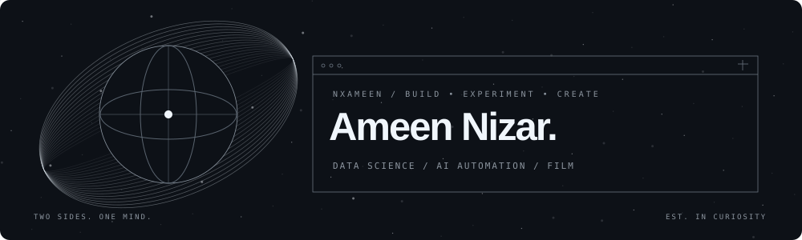

  

<h1 align="center">Hi 👋, I'm Ameen</h1>

<strong>Data Science &amp; AI Automation Learner</strong> Python in the notebook. Intention in every frame.

  <a href="https://zeeka-portfolio.vercel.app/">Portfolio</a> &nbsp; / &nbsp;
  <a href="https://www.linkedin.com/in/ameen-nizar/">LinkedIn</a> &nbsp; / &nbsp;
  <a href="https://github.com/NxAmeen?tab=repositories">Projects</a>

---

<h2 align="center">About me</h2>

I'm **Ameen Nizar**, exploring the intersection of data, intelligent systems and useful automation. I learn by building: from machine-learning classifiers and document chatbots to analytics dashboards and connected workflows.

- **My foundation:** Python, SQL, data analysis, machine learning, NLP and n8n.
- **Currently exploring:** AI agents, Claude skills, Higgsfield and more capable automations.
- **Going deeper next:** neural networks, deep learning, LLMs and RAG, building on completed project experience.
- **My creative side:** professional videography and video editing as **Zeekaedits**.

<em>Curiosity in the code. Intention in every frame.</em>

---

<h2 align="center">Tech stack</h2>

  

  <strong>Data &amp; ML</strong> 
  NumPy · Pandas · Matplotlib · Seaborn · scikit-learn  
  <strong>Analytics &amp; automation</strong> 
  SQL · Power BI · DAX · Power Query · n8n · REST APIs  
  <strong>Project experience</strong> 
  NLP · ResNet50 · MLflow · MiniLM · pgvector · Neon · Render

---

<h2 align="center">Selected builds</h2>

| Project | What I built | Focus |
| :--- | :--- | :--- |
| [NightStay](https://github.com/NxAmeen/Night-Stay---Room-Type-Intelligence) | NYC Airbnb room-type classification with class probabilities and input validation. | Python · scikit-learn · FastAPI |
| [Olist intelligence](https://github.com/NxAmeen/PostgreSql-x-PowerBi) | A nine-page analytics report connecting sales, delivery and customer reviews. | PostgreSQL · Power BI · DAX |
| [Ask your PDF](https://zeeka-portfolio.vercel.app/#projects) | A RAG chatbot with source-cited answers and a fallback when the document has no answer. | MiniLM · pgvector · FastAPI |
| [Breast ultrasound classifier](https://zeeka-portfolio.vercel.app/#projects) | Image classification with augmentation, weighted loss and experiment tracking. Research project; not a clinical tool. | ResNet50 · BUSI · MLflow |

More context and creative work on <a href="https://zeeka-portfolio.vercel.app/">my portfolio</a>.

---

<h2 align="center">Beyond the notebook</h2>

  Videography · Video editing · Motion graphics · Colour &amp; sound  
   
  Premiere Pro · After Effects · Photoshop · Lightroom

---

<h2 align="center">GitHub activity</h2>

  

---

<h2 align="center">Let's connect</h2>

  
  

Build something useful. Make something meaningful.

